# DWS System — Software Architecture Reference

**Document Version:** 1.0  
**System Version:** DWS System v1.0, Build 005.1  
**Date:** 2026-06-22  
**Status:** Engineering hardening  
**Author:** Ashmit Singh  

---

## Table of Contents

1. [Executive Overview](#1-executive-overview)
2. [Repository Structure](#2-repository-structure)
3. [Software Architecture](#3-software-architecture)
4. [Runtime Architecture](#4-runtime-architecture)
5. [Hardware Architecture](#5-hardware-architecture)
6. [SimBus Architecture](#6-simbus-architecture)
7. [Finite State Machine](#7-finite-state-machine)
8. [Vision System](#8-vision-system)
9. [Measurement Pipeline](#9-measurement-pipeline)
10. [Database Design](#10-database-design)
11. [Configuration System](#11-configuration-system)
12. [API Architecture](#12-api-architecture)
13. [HMI Architecture](#13-hmi-architecture)
14. [Deployment](#14-deployment)
15. [Threading Model](#15-threading-model)
16. [Error Handling](#16-error-handling)
17. [Data Flow](#17-data-flow)
18. [Engineering Decisions](#18-engineering-decisions)
19. [Performance Considerations](#19-performance-considerations)
20. [Scalability](#20-scalability)
21. [Current Limitations](#21-current-limitations)
22. [Future Roadmap](#22-future-roadmap)
23. [Conclusion](#23-conclusion)

---

# 1. Executive Overview

## 1.1 Purpose of the Project

The DWS (Dimensioning, Weighing & Scanning) system is an industrial parcel measurement station designed for logistics, warehouse automation, and shipping environments. The system captures the physical dimensions (length, width, height), actual weight, volumetric weight, and chargeable weight of parcels, associates each measurement with a barcode (AWB / tracking number), persists transaction records to a local SQLite database, archives annotated images and point clouds, and presents live operator feedback through a web-based Human-Machine Interface (HMI).

The repository implements a complete edge-deployable measurement pipeline built around an Intel RealSense D455 depth camera, a serial-connected industrial weighing scale, and a USB HID barcode scanner. The software was redesigned from an earlier Cognex-based vision pipeline into a RealSense-driven intelligent vision system with modular Python nodes orchestrated by a finite state machine.

## 1.2 Engineering Goals

| Goal | Implementation |
|------|----------------|
| Deterministic transaction sequencing | Barcode-triggered FSM with weight stability gating |
| Accurate dimension extraction | Dual vision pipeline: legacy live locking + Perception Engine v7 refinement |
| Operator visibility | WebSocket live updates, MJPEG stream, REST analytics API |
| Edge reliability | Single-process runtime, honest health monitoring, graceful shutdown |
| Auditability | SQLite persistence, snapshot archival, error logging with severity |
| Deployability | Headless `deploy/run.sh`, systemd unit, central YAML configuration |
| Calibration governance | Reference-box calibration, auto-calibration wizard, 90/100 shipment lock |

## 1.3 Design Philosophy

The architecture follows several industrial automation principles evident throughout the codebase:

- **Single-process cohesion:** All functional nodes share one Python process and one `SimBus` singleton, eliminating inter-process messaging overhead and guaranteeing synchronous service calls within the transaction path.
- **Fail-closed transaction semantics:** Any terminal error cancels the current transaction, resets vision state, persists the error, and returns the FSM to `IDLE` (or `CALIBRATION_REQUIRED` in production mode) rather than leaving the system stuck in `ERROR`.
- **Honest observability:** Health checks perform real hardware probes (frame reads, scale reading age, disk usage, calibration file validation) rather than assuming healthy status.
- **Separation of live tracking from capture refinement:** The legacy `realsense_vision` engine handles continuous frame processing, parcel locking, and human rejection; Perception Engine v7 runs once per locked transaction via `perception_bridge.py` for point cloud persistence and optional dimensional refinement.
- **Configuration without code edits:** Runtime-tunable parameters live in `config/dws_params.yaml`, with environment variable overrides for deployment-specific values.

## 1.4 Why This Architecture Was Chosen

The system uses a **ROS2-compatible node layout** (`package.xml`, `setup.py`, `launch/dws_launch.py`) but executes as a **SimBus-backed single process** via `run_dws.py`. This hybrid approach was chosen because:

1. The full ROS2 middleware is not required for a single-station edge appliance; SimBus provides pub/sub and services using only Python stdlib (`threading`, `queue`).
2. The node class structure maps directly to a future ROS2 port — each node class documents the equivalent `create_publisher` / `create_subscription` / `create_service` calls.
3. SQLite, RealSense, and serial I/O benefit from shared memory and synchronous service calls during the critical barcode→capture→save path.
4. A separate FastAPI process (`api_server.py`) serves REST endpoints and reads the same SQLite database, allowing external systems to query history without joining the in-process bus.

---

# 2. Repository Structure

## 2.1 Top-Level Hierarchy

```
dws_finalv7/
├── VERSION                          # System version stamp (v1.0, Build 005.1)
├── CHANGELOG.md                     # Build-level change history
└── dws_ws/                          # ROS2 colcon workspace root
    └── src/
        └── dws_ros2/                # Primary Python package
            ├── package.xml          # ROS2 package manifest
            ├── setup.py             # setuptools entry points + dependencies
            ├── VERSION              # Package-local version
            ├── CHANGELOG.md         # Package changelog
            ├── README.md            # Operator/developer quick start
            ├── start_dws.sh         # Interactive dev launcher (gnome-terminal)
            ├── api_server.py        # FastAPI REST server (separate process)
            ├── config/
            │   └── dws_params.yaml  # Central runtime configuration
            ├── deploy/
            │   ├── run.sh           # Headless process manager
            │   ├── stop.sh          # Stop helper
            │   ├── install_service.sh
            │   └── dws.service      # systemd unit template
            ├── hmi/
            │   └── index.html       # Single-page operator terminal
            ├── launch/
            │   └── dws_launch.py    # ROS2 launch file (multi-process, not primary runtime)
            ├── test/
            │   ├── test_dws_system.py
            │   └── test_realsense_dws.py
            └── dws_ros2/            # Python package source
                ├── run_dws.py       # **Primary entry point**
                ├── sim_bus.py       # In-process message bus
                ├── messages.py      # Dataclass message definitions
                ├── paths.py         # Filesystem path resolver
                ├── config_loader.py # YAML config loader
                ├── orchestrator_node.py
                ├── vision_node_realsense.py
                ├── vision_node.py   # Legacy (non-RealSense) vision node
                ├── scale_node.py
                ├── barcode_node.py
                ├── database_node.py
                ├── hmi_bridge_node.py
                ├── sync_worker_node.py
                ├── health_monitor.py
                ├── disk_retention.py
                ├── perception_bridge.py
                ├── simulate.py
                ├── realsense_vision/    # Legacy live measurement pipeline
                └── perception_engine/   # Perception Engine v7 (vendored SDK)
```

## 2.2 Major Folder Responsibilities

| Folder / Module | Purpose | Dependencies | Why It Exists |
|-----------------|---------|--------------|---------------|
| `dws_ros2/` (package root) | ROS2 packaging, deployment scripts, HMI assets | colcon, ament | Standard ROS2 package layout for build/install |
| `dws_ros2/dws_ros2/` | All runtime Python nodes and engines | numpy, opencv, pyrealsense2, etc. | Core application logic |
| `realsense_vision/` | Live depth processing, locking, visualization, auto-calibration | RealSense, OpenCV, YOLO | Original RealSense measurement pipeline tuned for continuous operation |
| `perception_engine/` | Single-shot SDK-style measurement with OBB, voxel volume, confidence | Open3D, scikit-learn | Higher-fidelity capture-time refinement and point cloud export |
| `config/` | YAML parameters | PyYAML via `config_loader` | Operator-tunable settings without recompilation |
| `deploy/` | Production startup, systemd integration | bash, colcon | Headless edge deployment |
| `hmi/` | Operator web UI | Browser, WebSocket, REST | Field operator interaction |
| `captures/` (runtime) | JPEG snapshots, `latest.jpg` | Written by `SnapshotManager`, MJPEG | Transaction image archival |
| `captures/pointclouds/` (runtime) | `.ply` point clouds | Written by `perception_bridge` | 3D audit artifacts |
| `realsense_vision/calibration/` | `.npy` calibration artifacts | Written by `AutoCalibrationV2`, read by both engines | Station-specific geometric baseline |

## 2.3 External Runtime Directories

Resolved by `paths.py` (not necessarily in the repository):

| Path | Env Override | Purpose |
|------|--------------|---------|
| `~/dws_data.db` | `DWS_DB_PATH` | SQLite database |
| `~/.dws/logs/` | `DWS_LOG_DIR` | Process logs (deploy mode) |
| `~/.dws/run/` | `DWS_RUN_DIR` | PID files |
| `backups/` | `DWS_BACKUP_DIR` | Database backup copies |
| `exports/` | `DWS_EXPORT_DIR` | CSV export destination |

---

# 3. Software Architecture

## 3.1 Major Subsystems

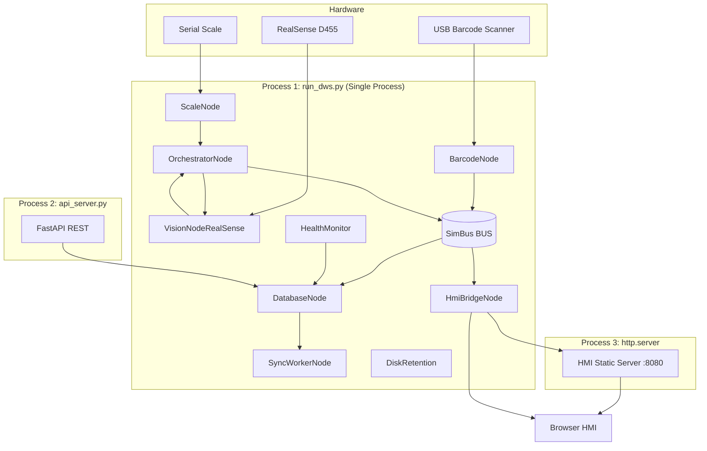

## 3.2 Subsystem Responsibilities

| Subsystem | Primary Responsibility | Boundary |
|-----------|----------------------|----------|
| **BarcodeNode** | USB HID scanner input → `/dws/barcode` publish | Does not interpret AWB semantics |
| **ScaleNode** | Serial weight polling, statistical stability | Does not trigger transactions |
| **VisionNodeRealSense** | Camera I/O, live stream, capture, calibration | Does not write DB directly |
| **OrchestratorNode** | FSM, transaction assembly, calibration FSM | Central workflow coordinator |
| **DatabaseNode** | SQLite CRUD, BUS service handlers | Sole DB writer in main process |
| **HmiBridgeNode** | WebSocket broadcast, MJPEG, HTTP file serve | Reads DB directly for history |
| **SyncWorkerNode** | Cloud HTTP push of unsynced rows | Disabled by default |
| **HealthMonitor** | Periodic composite health → `health_status` table | Read by API `/health` |
| **DiskRetention** | Prune old capture/pointcloud files | Never deletes DB rows |
| **api_server.py** | External REST/query interface | Separate process, DB reader |

## 3.3 Layered Architecture

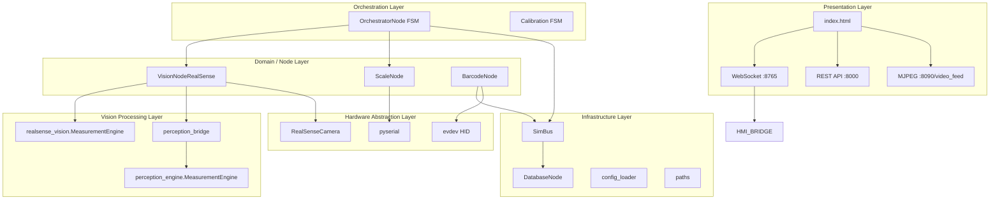

## 3.4 Module Dependency Graph

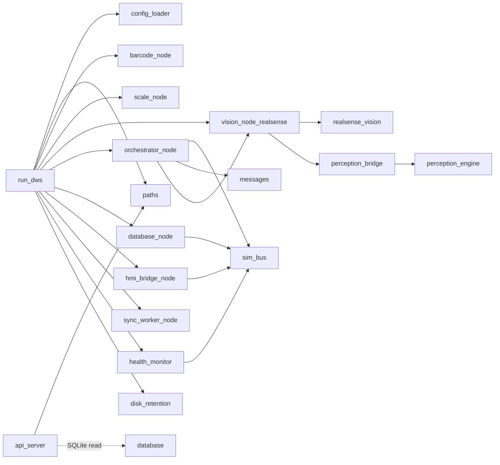

---

# 4. Runtime Architecture

## 4.1 Process Lifecycle

The supported production runtime consists of **three OS processes**:

| Process | Command | Port(s) |
|---------|---------|---------|
| Backend | `ros2 run dws_ros2 run_dws` | WS 8765, HTTP 8090 |
| REST API | `uvicorn api_server:app --port 8000` | 8000 |
| HMI static | `python3 -m http.server 8080` (serves `hmi/`) | 8080 |

> **Note:** `HmiBridgeNode` also serves `index.html` at `http://localhost:8090/`, so the operator UI is accessible on either port 8080 (static) or 8090 (embedded in aiohttp).

## 4.2 Initialization Order

From `run_dws.py`:

1. Register SIGTERM → `KeyboardInterrupt` handler
2. Load config via `get_config()`
3. Instantiate all node objects (no hardware start yet)
4. **Start sequence:**
   1. `database.start()` — schema create/migrate, register BUS services
   2. `hmi.start()` — WebSocket + aiohttp MJPEG server
   3. `sync_worker.start()` — background poll thread (no-op if disabled)
   4. `health_monitor.start()` — periodic health writes
   5. `disk_retention.start()` — immediate sweep + hourly loop
   6. `scale.start()` — serial poll thread
   7. `vision.start()` — camera start (retries), stream thread
   8. `orchestrator.start()` — boot FSM, open session, subscribe barcode
   9. `barcode.start()` — scanner poll thread (last, to avoid triggers before ready)

## 4.3 Orchestrator Boot FSM

During `orchestrator.start()`:

1. Subscribe to `/dws/barcode`
2. `_load_persisted_calibration_state()` from `system_state` table
3. Start `_dev_mode_poll_loop` thread (5s interval)
4. `BUS.call_service("/dws/open_session", ...)`
5. `CHECKING_CAMERA` → `vision_node.check_health()`
6. `CHECKING_CALIBRATION` → `check_calibration_files()`; may halt at `CALIBRATION_REQUIRED` (unless developer mode)
7. `CHECKING_SCALE` → up to 10× `scale_node.check_health()` with 1s sleep
8. `IDLE`

## 4.4 Shutdown Order

From `run_dws.py` `finally` block (reverse of critical path):

1. `barcode.stop()`
2. `health_monitor.stop()`
3. `disk_retention.stop()`
4. `scale.stop()`
5. `vision.stop()` — stream thread join, camera pipeline stop
6. `orchestrator.stop()` — close session
7. `hmi.stop()`
8. `sync_worker.stop()`
9. `database.stop()` — close SQLite connection

SIGTERM is routed to the same path as Ctrl-C, ensuring systemd `ExecStop` triggers graceful cleanup.

## 4.5 Startup Sequence Diagram

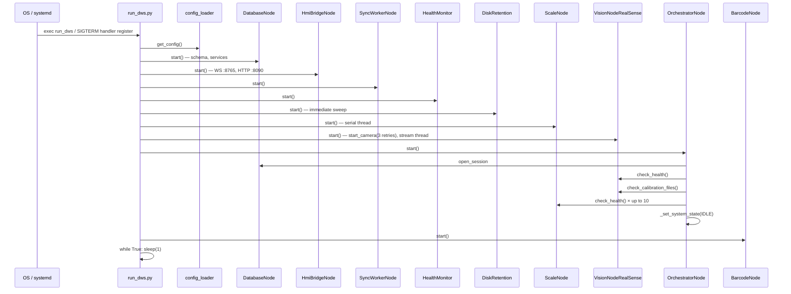

## 4.6 Resource Ownership

| Resource | Owner | Access Pattern |
|----------|-------|----------------|
| RealSense pipeline | `VisionNodeRealSense.camera` | `_camera_lock` mutex |
| SQLite connection | `DatabaseNode._conn` | `DatabaseNode._lock` |
| Latest weight state | `ScaleNode` | `_state_lock` |
| FSM / transaction state | `OrchestratorNode` | `_state_lock`, `_calibration_lock` |
| MJPEG JPEG buffer | `VisionNodeRealSense._latest_jpeg` | Written by stream/capture threads |
| SimBus subscribers | Global `BUS` | Per-callback dispatch threads |
| Health snapshot | `HealthMonitor.latest` + DB row | Written by health thread |

---

# 5. Hardware Architecture

## 5.1 Intel RealSense D455

### Communication Protocol

- **Library:** `pyrealsense2` (Intel RealSense SDK 2.0)
- **Streams:** Depth (`rs.format.z16`, 1280×720 @ configurable FPS) + Color (`rs.format.bgr8`, aligned to color)
- **Alignment:** `rs.align(rs.stream.color)` — depth registered to color optical frame
- **On-device filtering chain:** spatial → temporal → hole filling filters applied per frame in `RealSenseCamera.get_frames()`

### Software Interface

| Component | File | Key Methods |
|-----------|------|-------------|
| `RealSenseCamera` | `realsense_vision/realsense_camera.py` | `start()`, `get_frames()`, `get_intrinsics()`, `stop()` |
| `VisionNodeRealSense` | `vision_node_realsense.py` | `start_camera()`, `process_once()`, `capture_measurement()`, `check_health()` |

### Initialization

1. `RealSenseCamera` constructed with width/height from `CalibrationManager.frame_width/height`, FPS from config
2. Hardware start deferred to `start_camera(retries=3, retry_delay=2.0)` — **never raises**; sets `camera_ready=False` on failure
3. Warmup: 60 frame waits inside `RealSenseCamera.start()`
4. Intrinsics loaded and pushed to `CalibrationManager.update_intrinsics()`

### Failure Handling

| Condition | Behavior |
|-----------|----------|
| Camera absent at boot | Process continues; health reports `CAMERA_NOT_STARTED` |
| Frame read failure | `get_frames()` returns `None`; stream loop sleeps and retries |
| Health check failure | `check_health()` returns `{valid: False, reason: ...}` |
| Capture timeout (10s) | Orchestrator receives `{valid: False, reason: "TIMEOUT"}` |
| Camera error during capture | `{valid: False, reason: "CAMERA_ERROR"}` |

## 5.2 Weighing Scale

### Communication Protocol

- **Interface:** RS-232 serial via `pyserial`
- **Default port:** `/dev/ttyUSB0` @ 9600 baud (configurable)
- **Protocol:** ASCII weight strings, STX/ETX stripped, regex float extraction
- **Read pattern:** `read_until(b'\r')` in 20ms poll loop

### Software Interface

| Component | File | Key Methods |
|-----------|------|-------------|
| `ScaleNode` | `scale_node.py` | `start()`, `get_measurement()`, `check_health()` |

### Stability Algorithm

Rolling buffer of `buffer_size` (default 20) samples (~2s window at 20Hz):

- **Spread:** `max - min < spread_threshold_kg` (default 0.03 kg)
- **Std dev:** `pstdev < std_dev_threshold_kg` (default 0.012 kg)
- **Consecutive windows:** `required_stable_windows` (default 8) consecutive statistically-stable windows
- **Zero gate:** weight `< zero_threshold_kg` (0.05) forces unstable

Orchestrator additionally requires **2.0 seconds continuous stability** (`REQUIRED_STABLE_TIME`) after barcode scan, independent of scale node's instantaneous `stable` flag transitions.

### Failure Handling

| Condition | Behavior |
|-----------|----------|
| Serial disconnect | Exception logged, port closed, reconnect attempted every 2s |
| No readings within 2s | `check_health()` → `SCALE_NO_READINGS` |
| Weight unstable (10s timeout) | FSM error `WEIGHT_UNSTABLE_TIMEOUT` |
| Empty scale at scan | FSM error `NO_PARCEL` |

## 5.3 Barcode Scanner

### Communication Protocol

- **Primary mode:** USB HID keyboard emulation via Linux `evdev`
- **Detection:** Scans `/dev/input/event*` for device names containing `scanner`, `symbol`, or `zebra`
- **Input assembly:** Key events accumulated until `KEY_ENTER`, then published
- **Fallback mode:** stdin `input()` prompt (development); EOFError handled for headless/service mode

### Software Interface

| Component | File | Key Methods |
|-----------|------|-------------|
| `BarcodeNode` | `barcode_node.py` | `start()`, `_publish()` → `BUS.publish("/dws/barcode", BarcodeMsg)` |

### Initialization

- Scanner detection at construct time; re-detection every 10s if device was absent at boot
- Started **last** in `run_dws.py` to prevent premature triggers

### Failure Handling

| Condition | Behavior |
|-----------|----------|
| No scanner found | Falls back to manual stdin mode |
| USB disconnect mid-scan | `OSError` caught, device nulled, fallback enabled |
| Scan cooldown (2s) | Duplicate publish suppressed, buffer cleared |
| Empty barcode | Orchestrator error `EMPTY_BARCODE` |
| Duplicate AWB within 2s | Orchestrator error `DUPLICATE_BARCODE` |

---

# 6. SimBus Architecture

## 6.1 Design

`SimBus` (`sim_bus.py`) replaces ROS2 `rclpy` pub/sub and services for single-process deployment:

```python
BUS = SimBus()  # module-level singleton
```

## 6.2 Publish/Subscribe

- **Registration:** `BUS.subscribe(topic, callback, queue_depth=20)` → returns opaque `cb_id`
- **Dispatch:** Each subscriber gets a dedicated daemon thread + bounded `queue.Queue`
- **Publish:** `BUS.publish(topic, msg)` enqueues to all subscriber queues; drops on `queue.Full` with warning
- **Thread safety:** Subscriber list protected by `_lock`; callbacks never run on publisher thread

## 6.3 Services

- **Registration:** `BUS.register_service(name, handler)`
- **Call:** `BUS.call_service(name, request, timeout=5.0)` — spawns daemon thread, waits on `threading.Event`
- **Timeout:** Returns `None` on timeout; logs error

## 6.4 Registered Topics

| Topic | Publisher(s) | Subscriber(s) | Message Type |
|-------|-------------|---------------|--------------|
| `/dws/barcode` | BarcodeNode | OrchestratorNode | `BarcodeMsg` |
| `/dws/transaction` | OrchestratorNode | HmiBridgeNode | `TransactionMsg` |
| `/dws/error` | OrchestratorNode | HmiBridgeNode | dict |
| `/dws/system_state` | OrchestratorNode | HmiBridgeNode | dict |
| `/dws/calibration_required` | OrchestratorNode | HmiBridgeNode | dict |
| `/dws/calibration_warning` | OrchestratorNode | HmiBridgeNode | dict |
| `/dws/calibration_started` | OrchestratorNode | HmiBridgeNode | dict |
| `/dws/calibration_pass` | OrchestratorNode | HmiBridgeNode | dict |
| `/dws/calibration_failed` | OrchestratorNode | HmiBridgeNode | dict |

## 6.5 Registered Services

| Service | Handler | Purpose |
|---------|---------|---------|
| `/dws/save_transaction` | `DatabaseNode._handle_save` | Persist transaction |
| `/dws/save_error` | `DatabaseNode._handle_error` | Persist error |
| `/dws/get_calibration_boxes` | `DatabaseNode.get_calibration_boxes` | Reference boxes |
| `/dws/save_calibration_result` | `DatabaseNode.save_calibration_result` | Calibration history |
| `/dws/get_system_state` | `DatabaseNode.get_system_state` | Read flags |
| `/dws/update_system_state` | `DatabaseNode.update_system_state` | Write flags |
| `/dws/save_health_status` | `DatabaseNode.save_health_status` | Health snapshot |
| `/dws/get_health_status` | `DatabaseNode.get_health_status` | Read health |
| `/dws/open_session` | `DatabaseNode.open_session` | Shift open |
| `/dws/close_session` | `DatabaseNode.close_session` | Shift close |
| `/dws/update_session_on_transaction` | `DatabaseNode.update_session_on_transaction` | Live counters |
| `/dws/get_sessions` | `DatabaseNode.get_sessions` | History |
| `/dws/get_current_session` | `DatabaseNode.get_current_session` | Active shift |

## 6.6 Message Flow — Normal Transaction

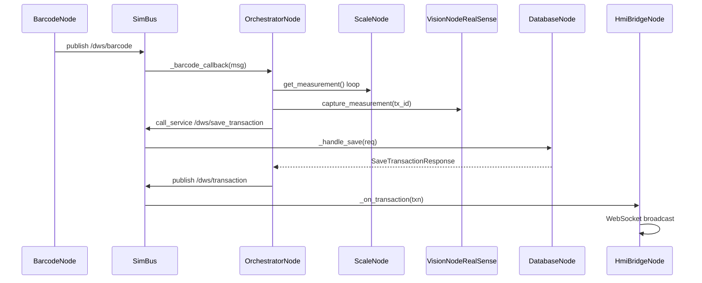

## 6.7 Advantages and Trade-offs

| Advantages | Trade-offs |
|------------|------------|
| Zero ROS2 runtime dependency for edge deploy | Not suitable for multi-process node isolation |
| Synchronous service calls in transaction path | `api_server.py` cannot call BUS services |
| Typed Python dataclasses | No schema enforcement at compile time |
| Per-subscriber isolation prevents callback blocking | Queue overflow drops messages |
| Trivial to debug in single debugger session | No distributed tracing across processes |

---

# 7. Finite State Machine

## 7.1 System States

| State | Purpose | Entry Condition | Exit Condition |
|-------|---------|---------------|----------------|
| `BOOTING` | Initial state before checks | Process start | First `_set_system_state` call |
| `CHECKING_CAMERA` | Verify RealSense alive | `orchestrator.start()` | Camera health pass/fail |
| `CHECKING_CALIBRATION` | Verify `.npy` files | Camera OK | Files valid or dev bypass |
| `CHECKING_SCALE` | Verify scale readings | Calibration check done | Scale health pass |
| `CALIBRATION_REQUIRED` | Block normal scans | Missing/invalid cal or 100 shipments | Successful calibration |
| `CALIBRATION_RUNNING` | Auto-cal wizard active | `start_auto_calibration()` | Pass/fail result |
| `IDLE` | Ready for barcode | Boot complete / recovery | Barcode received |
| `WAITING_FOR_WEIGHT` | Awaiting parcel + stability | Barcode accepted | Stable 2s or timeout |
| `STABILIZING` | Stability timer running | First stable reading | 2s continuous or reset |
| `CAPTURING` | Vision acquisition | Weight stable | Capture complete |
| `SAVING` | DB write in progress | Valid dimensions | Save response |
| `COMPLETE` | Transaction success (transient) | DB save OK | Immediate → IDLE |
| `ERROR` | Terminal error (transient) | `_raise_error()` | Immediate recovery → IDLE |

## 7.2 Transaction FSM Flow

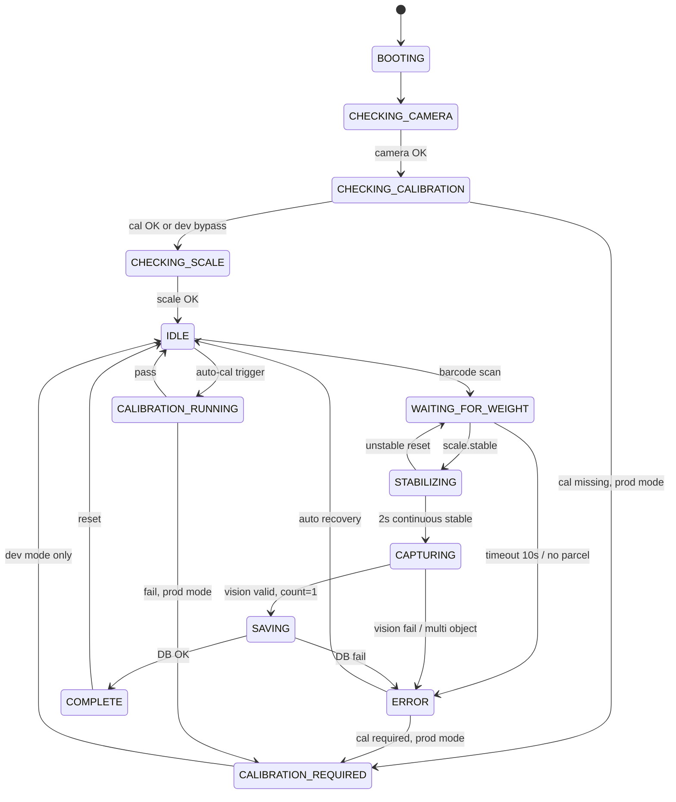

## 7.3 Timeout Behaviour

| Timer | Value | Location | On Expiry |
|-------|-------|----------|-----------|
| Weight stability | 10s (`STABILITY_TIMEOUT`) | `_barcode_callback` | `WEIGHT_UNSTABLE_TIMEOUT` |
| Required stable duration | 2s (`REQUIRED_STABLE_TIME`) | Orchestrator | Must elapse while continuously stable |
| Vision capture | 10s (`capture_measurement` default) | VisionNodeRealSense | `TIMEOUT` |
| Barcode dedup | 2s (`BARCODE_DEDUP_WINDOW`) | Orchestrator | `DUPLICATE_BARCODE` |
| Scanner cooldown | 2s (`SCAN_COOLDOWN`) | BarcodeNode | Scan ignored |
| Service call | 5s default | SimBus | Returns `None` |

## 7.4 Calibration FSM

Two calibration paths share `_calibration_lock` (non-reentrant):

1. **Reference box calibration:** Scan AWB matching `calibration_boxes` table → `_run_calibration(awb)`
2. **Auto calibration:** HMI/API triggers `orchestrator.start_auto_calibration()` → `vision_node.run_auto_calibration()`

Both paths:
- Wait for 2s weight stability
- Call `capture_measurement()`
- Compare against reference (box) or write `.npy` files (auto)
- Update `_calibration_required`, `_calibration_locked`, `_shipments_since_calibration`
- Persist via `_persist_calibration_state()`

**Shipment counter governance:**
- At 90 shipments: publish `/dws/calibration_warning`
- At 100 shipments: `_require_calibration()` — blocks scans in production mode

## 7.5 Failure Paths

All failures route through `_raise_error(error_type, awb, message, image_path=None)`:

1. Set `_current_tx_failed = True`
2. Publish `/dws/system_state` → `ERROR`
3. `_reset_vision_state()`
4. `BUS.call_service("/dws/save_error", payload)` with derived severity/component
5. Publish `/dws/error` for HMI popup
6. `_reset_transaction_state()`
7. Transition to `CALIBRATION_REQUIRED` (if required && !dev mode) else `IDLE`

---

# 8. Vision System

## 8.1 Why Two Pipelines Exist

The system maintains **two distinct vision pipelines** by design:

| Pipeline | Role | When It Runs |
|----------|------|--------------|
| **Legacy (`realsense_vision`)** | Continuous live processing, parcel locking, human detection, MJPEG overlays | Every frame in `process_once()` / stream loop |
| **Perception Engine v7 (`perception_engine`)** | Single-shot geometric measurement, OBB fitting, voxel volume, confidence scoring, `.ply` export | Once per locked transaction via `perception_bridge.refine_measurement()` |

**Rationale (from `perception_bridge.py` docstring):**
- Keeps the live tracking/locking loop untouched — no regression risk to proven behavior
- PE7 loads calibration once (cached `_ENGINE` singleton) — avoids per-frame overhead
- Point cloud persistence is industrial glue, not measurement logic — belongs in the bridge
- PE7 failure never blocks the transaction — legacy L/W/H remain authoritative for DB save

> **Important implementation detail:** Although PE7 computes refined dimensions, `capture_measurement()` returns legacy engine values for `length`, `width`, `height` in the orchestrator transaction. PE7 output is used for `pointcloud_path` logging and archival; dimensional authority at transaction commit is the legacy locked values.

## 8.2 Legacy Pipeline Architecture

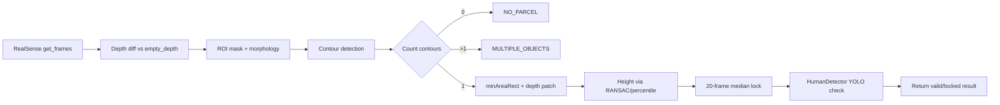

**Key classes:**
- `CalibrationManager` — loads `stable_empty_depth.npy`, `noise_map.npy`, `system_geometry.npy`
- `MeasurementEngine` — core 2D depth segmentation + locking
- `HumanDetector` — YOLOv8s human overlap rejection
- `VisualizationManager` — annotated overlay rendering
- `SnapshotManager` — JPEG persistence on capture
- `AutoCalibrationV2` — writes calibration `.npy` files

## 8.3 Perception Engine v7 Architecture

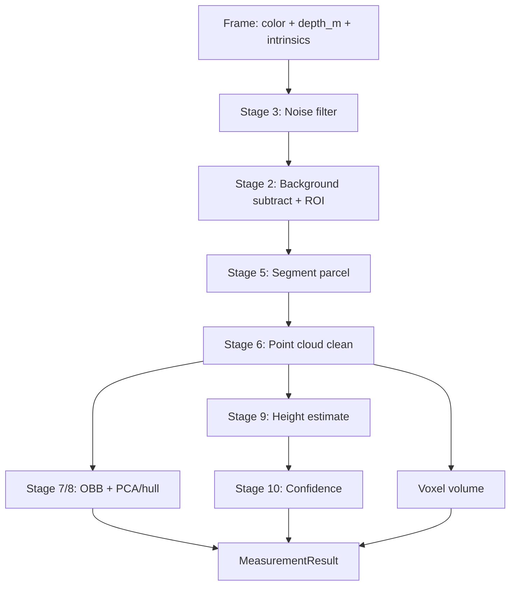

## 8.4 Perception Bridge

`perception_bridge.refine_measurement()`:

**Input:** BGR color, raw depth units, intrinsics dict, calibration dir, optional `tx_id`

**Output contract:**
```python
{
    "success": bool,
    "failure_reason": str | None,
    "length_mm", "width_mm", "height_mm": float,
    "volume_mm3": float,
    "confidence": float,  # 0-100
    "point_count": int,
    "shape_type": str,
    "pointcloud_path": str | None,
    "processing_time_ms": float,
}
```

Never raises — all failures return `success=False`.

---

# 9. Measurement Pipeline

## 9.1 Stage Reference — Legacy Pipeline (`realsense_vision`)

| Stage | Input | Processing | Output |
|-------|-------|------------|--------|
| **Depth capture** | RealSense aligned depth + color | `get_frames()`, spatial/temporal/hole fill | `(H,W)` float32 depth, BGR color |
| **Background subtraction** | `empty_depth`, current depth | `depth_diff_safe`: `empty - current`, clip negative | Diff map |
| **Thresholding** | Diff map | `DEPTH_THRESHOLD_MIN=40`, `MAX=1000` mm | Binary foreground |
| **ROI clip** | Foreground + geometry | `roi_x1..y2` from calibration | Masked region |
| **Morphology** | Binary mask | Open/close, CC area filter (≥2500 px) | Clean mask |
| **Segmentation** | Mask | External contours, area 4000–25% frame | Single contour or reject |
| **Edge touch check** | Contour bbox vs ROI | 8px margin rejection | `EDGE_TOUCH` if violated |
| **Dimension (L/W)** | minAreaRect + depth patch | Pinhole `pixels_to_mm()` at object depth | `length_mm`, `breadth_mm` with TRIM factors |
| **Height** | Per-pixel delta in mask | RANSAC height or P55 percentile, TRIM_H=0.971 | `height_mm` |
| **Depth noise gate** | Delta std dev | Reject if `depth_std > 180` | `DEPTH_NOISE` |
| **Sanity gate** | L, W, H | 40–3000mm L/W, 10–2000mm H | `SANITY_FAIL` |
| **Stabilization** | 20-frame medians | Lock after `LOCK_FRAMES=20`, drift check 15mm | `locked=True` |
| **Human rejection** | Color frame | YOLOv8s, overlap >1500px | Invalid if human detected |
| **Confidence** | Buffer fill ratio | `len(buffer)/LOCK_FRAMES` capped at 1.0 | 0–1 float |
| **Snapshot** | Annotated frame | JPEG write via `SnapshotManager` | `image_path` |

## 9.2 Stage Reference — Perception Engine v7

| Stage | Module | Input | Output |
|-------|--------|-------|--------|
| **1. Capture** | `capture/frame.py` | Raw arrays | `Frame` dataclass (color, depth_raw, depth_m, intrinsics) |
| **2. Background subtract** | `background/subtractor.py` | depth_m, stable_empty_depth_m | `(foreground_mask, height_above_empty_m)` |
| **3. Noise filter** | `background/noise_filter.py` | depth_m, noise_map | Filtered depth (temporal optional) |
| **4. Plane removal** | `geometry/plane.py` | Foreground points | Bed plane segmented (inside Stage 5) |
| **5. Segmentation** | `segmentation/parcel_segmenter.py` | mask, depth, intrinsics | `SegmentationResult` (points, mask, multiple_parcels flag) |
| **6. Point cloud** | `geometry/pointcloud.py` | Masked deprojection | Cleaned N×3 points |
| **7/8. OBB** | `measurement/obb.py` | Points + plane normal | Oriented bbox, hull corners |
| **9. Height** | `measurement/estimator.py` | Points, scale_height/depth mm | Height in meters, planar top flag |
| **10. Confidence** | `measurement/confidence.py` | Points, plane, mask, hull | 0–100 overall score |
| **Volume** | `measurement/volume_estimator.py` | Points, scale_depth_m | Voxel volume mm³ or L×W×H fallback |
| **Snapshot (.ply)** | `perception_bridge._save_pointcloud` | parcel_cloud | Open3D `.ply` file |

## 9.3 Processing Diagram — Capture Time

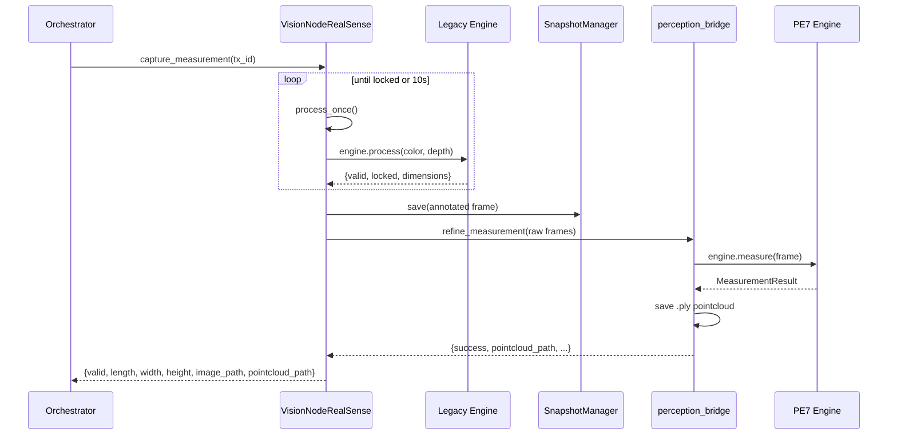

---

# 10. Database Design

## 10.1 Engine Configuration

- **File:** Resolved by `paths.resolve_db_path()` (default `~/dws_data.db`)
- **Mode:** WAL (`PRAGMA journal_mode=WAL`)
- **Sync:** `PRAGMA synchronous=NORMAL`
- **FK:** `PRAGMA foreign_keys=ON`
- **Threading:** `check_same_thread=False`, guarded by `DatabaseNode._lock`

## 10.2 Entity-Relationship Diagram

```mermaid
erDiagram
    transactions {
        INTEGER id PK
        TEXT awb UK
        TEXT tx_id
        REAL length
        REAL width
        REAL height
        REAL weight
        INTEGER object_count
        REAL vol_weight
        REAL charge_weight
        REAL dim_factor
        TEXT station_id
        TEXT image_url
        TEXT pointcloud_url
        REAL timestamp
        TEXT created_at
        INTEGER sync_status
        REAL latency_ms
        TEXT operator
        REAL confidence
    }

    errors {
        INTEGER id PK
        TEXT error_type
        TEXT awb
        TEXT message
        TEXT created_at
        REAL timestamp
        TEXT image_url
        TEXT severity
        TEXT component
    }

    sessions {
        INTEGER id PK
        TEXT session_id UK
        TEXT station_id
        TEXT operator
        REAL started_at
        REAL ended_at
        INTEGER parcel_count
        INTEGER error_count
        REAL success_rate
        REAL mean_latency_ms
        REAL total_latency_ms
        TEXT status
    }

    calibration_boxes {
        INTEGER id PK
        TEXT awb UK
        TEXT name
        REAL length_mm
        REAL width_mm
        REAL height_mm
        REAL weight_kg
        REAL tolerance_percent
        INTEGER enabled
        TEXT created_at
    }

    calibration_history {
        INTEGER id PK
        TEXT box_awb
        INTEGER pass_fail
        REAL length_error_mm
        REAL width_error_mm
        REAL height_error_mm
        REAL weight_error_kg
        INTEGER count_error
        INTEGER image_received
        REAL confidence
        INTEGER override_used
        TEXT operator
        TEXT created_at
        REAL timestamp
    }

    system_state {
        INTEGER id PK "CHECK id=1"
        INTEGER calibration_required
        INTEGER calibration_locked
        INTEGER override_active
        INTEGER shipments_since_calibration
        REAL last_calibration_timestamp
        INTEGER developer_mode
        TEXT metrological_standard
        INTEGER strict_mode
        INTEGER allow_near_oos
        TEXT station_name
        TEXT operator_name
    }

    health_status {
        INTEGER id PK "CHECK id=1"
        INTEGER overall_ok
        INTEGER camera_ok
        TEXT camera_reason
        INTEGER scale_ok
        TEXT scale_reason
        INTEGER db_ok
        TEXT db_reason
        INTEGER disk_ok
        REAL disk_free_gb
        TEXT disk_reason
        INTEGER calibration_ok
        TEXT calibration_reason
        REAL checked_at
        TEXT checked_at_iso
    }

    session_stats {
        INTEGER id PK
        TEXT event
        TEXT detail
        REAL ts
    }
```

## 10.3 Indexes

| Index | Table | Column | Notes |
|-------|-------|--------|-------|
| `idx_transactions_awb` | transactions | awb | UNIQUE — duplicate AWB insert fails |

## 10.4 Transaction Flow

1. Orchestrator builds `TransactionMsg` with `sync_status=0`
2. `BUS.call_service("/dws/save_transaction", SaveTransactionRequest)`
3. `DatabaseNode._handle_save` INSERT with `sync_status=0`
4. On success: `update_session_on_transaction()` increments parcel_count, updates latency
5. On `IntegrityError`: returns `success=False` (duplicate AWB)
6. `SyncWorkerNode` later marks `sync_status=1` after cloud POST success

## 10.5 Migration Strategy

`DatabaseNode._migrate_schema()` runs at startup — **additive only**:

- Adds missing columns to `transactions`: `pointcloud_url`, `latency_ms`, `operator`, `confidence`
- Adds missing columns to `errors`: `image_url`, `severity`, `component`
- Adds missing columns to `calibration_history`: `operator`
- Adds missing columns to `system_state`: `developer_mode`, settings fields
- Creates unique AWB index if absent (logs error on duplicate data)

No downgrade path; old DB files forward-migrate automatically.

## 10.6 Health and Calibration Tables

- **`health_status`:** Single row (`id=1`), upserted every 5s by `HealthMonitor`
- **`system_state`:** Single row (`id=1`), seeded with defaults on first run (`developer_mode=1`)
- **`calibration_boxes`:** Reference boxes for manual calibration flow
- **`calibration_history`:** Append-only audit of calibration attempts

## 10.7 Session Tables

- **`sessions`:** One row per process run (`open` on orchestrator start, `closed` on stop)
- **`session_stats`:** Legacy event log table (read by API `/session`)

---

# 11. Configuration System

## 11.1 Configuration Loading

```python
from dws_ros2.config_loader import get_config
cfg = get_config()
```

Flow:
1. Start from `DEFAULTS` dict (hardcoded fallbacks)
2. Deep-merge `config/dws_params.yaml` if present
3. Apply `DWS_<SECTION>_<KEY>` environment overrides with type coercion
4. Cache result (use `load_config(force_reload=True)` to refresh)

## 11.2 Configuration Precedence

| Priority | Source | Example |
|----------|--------|---------|
| 1 (highest) | Environment variable | `DWS_SCALE_SERIAL_PORT=/dev/ttyUSB1` |
| 2 | YAML file | `scale.serial_port: /dev/ttyUSB0` |
| 3 (lowest) | `DEFAULTS` in code | `/dev/ttyUSB0` |

Path resolution (`paths.py`) follows similar precedence with `DWS_*_DIR` and `DWS_DB_PATH` overrides.

## 11.3 Config File Resolution Order

1. `DWS_CONFIG_PATH` env var
2. Source checkout: `<repo>/dws_ros2/config/dws_params.yaml`
3. colcon install: `<install>/share/dws_ros2/config/dws_params.yaml`
4. Legacy: `~/dws_ws/src/dws_ros2/config/dws_params.yaml`

## 11.4 Runtime Overrides

| Mechanism | Scope | Latency |
|-----------|-------|---------|
| `POST /settings` | `system_state` DB columns | ~5s for `developer_mode` (orchestrator poll) |
| `config_loader.save_config()` | Full YAML rewrite | Requires process restart for most nodes |
| Env vars at launch | Any leaf key | At process start only |

## 11.5 Complete Default Configuration

```yaml
system:
  station_id: STATION_01
  simulation_mode: false
scale:
  serial_port: /dev/ttyUSB0
  baudrate: 9600
  publish_rate_hz: 20
  buffer_size: 20
  spread_threshold_kg: 0.03
  std_dev_threshold_kg: 0.012
  required_stable_windows: 8
  zero_threshold_kg: 0.05
vision:
  camera_mode: hardware
  fps: 30
database:
  file: dws_data.db
  retention_days: 30
api:
  host: 0.0.0.0
  port: 8000
hmi:
  host: 0.0.0.0
  websocket_port: 8765
  http_port: 8090
  static_port: 8080
health:
  check_interval_seconds: 5
  min_free_disk_gb: 2.0
sync:
  enabled: false
  cloud_url: https://api.dws-cloud.example.com/v1/sync
  poll_interval_seconds: 10.0
```

---

# 12. API Architecture

**Base URL:** `http://localhost:8000`  
**Framework:** FastAPI + uvicorn (separate process from `run_dws.py`)  
**Database access:** Direct SQLite read/write via `get_conn()` — shares file with `DatabaseNode`

## 12.1 Endpoint Reference

### Core

| Method | Path | Purpose | DB Interaction | Error Handling |
|--------|------|---------|----------------|----------------|
| GET | `/` | Health ping | None | Always 200 |
| GET | `/health` | Composite health | Reads `health_status`, `system_state`, COUNT transactions | Returns `unknown` if no snapshot |
| GET | `/stats` | Totals + success rate | COUNT transactions/errors, AVG latency | Empty DB → zeros |
| GET | `/latest` | Most recent transaction | SELECT ORDER BY id DESC LIMIT 1 | Empty → `{}` |
| GET | `/history?limit&offset` | Paginated transactions | SELECT with LIMIT/OFFSET | Returns `[]` |
| GET | `/errors?limit&severity&component` | Error log | SELECT errors with filters | Returns `[]` |
| GET | `/session` | session_stats events | SELECT session_stats | Returns `[]` |
| GET | `/dashboard` | Composite summary | COUNT + latest | — |
| GET | `/metrics` | Average L/W/H/weight | AVG aggregates | Zero if empty |
| GET | `/system` | Station + cal flags | Reads system_state | Defensive on missing columns |

### Settings (Build 005)

| Method | Path | Purpose | DB Interaction |
|--------|------|---------|----------------|
| GET | `/settings` | All 6 editable fields | SELECT system_state |
| POST | `/settings` | Update settings body | UPDATE system_state WHERE id=1 |

Accepted POST keys: `developer_mode`, `metrological_standard`, `strict_mode`, `allow_near_oos`, `station_name`, `operator_name`

### Analytics

| Method | Path | Purpose |
|--------|------|---------|
| GET | `/error_breakdown` | GROUP BY error_type |
| GET | `/success_rate` | Pass/fail ratio |
| GET | `/weight_distribution` | Histogram buckets |
| GET | `/billing` | Actual vs chargeable totals |
| GET | `/scanner` | Online if last scan <5 min |

### Shifts (Build 003)

| Method | Path | Purpose |
|--------|------|---------|
| GET | `/shifts?limit` | Recent sessions |
| GET | `/shifts/current` | Open session stats |

### Export / Backup / Files (Build 005)

| Method | Path | Purpose |
|--------|------|---------|
| GET | `/export/csv?date_from&date_to&shift_id` | CSV download |
| POST | `/backup` | Copy DB to BACKUP_DIR |
| GET | `/calibration/latest` | Latest calibration_history row |
| GET | `/captures/{name}` | Serve JPEG (path traversal blocked) |
| GET | `/pointclouds/{name}` | Serve .ply download |

## 12.2 `/health` Response Semantics

- **`status: healthy`** — `overall_ok` from snapshot AND db_ok AND snapshot age ≤60s
- **`status: degraded`** — any check failed or stale snapshot
- **`status: unknown`** — no `health_status` row or `checked_at` unset
- **`stale: true`** — snapshot older than 60 seconds (~12 missed 5s cycles)
- **`developer_mode`** — informational only, does not affect overall status

---

# 13. HMI Architecture

## 13.1 Frontend

- **File:** `hmi/index.html` — single-page application (~2200 lines)
- **Style:** Apple-inspired industrial terminal (Inter/JetBrains Mono fonts)
- **Views:** Live terminal, history, errors, calibration, settings, analytics panes
- **Served by:**
  - Static: `python3 -m http.server 8080` in `hmi/` directory
  - Embedded: `HmiBridgeNode` aiohttp serves `index.html` at `http://localhost:8090/`

## 13.2 WebSocket

- **URL:** `ws://localhost:8765`
- **Server:** `websockets` library in dedicated asyncio thread
- **Initial payload on connect:** transaction history, error history, calibration boxes, system state
- **Live events:** transaction, error, calibration lifecycle, system_state

## 13.3 MJPEG Live Stream

- **URL:** `http://localhost:8090/video_feed`
- **Source:** `orchestrator.get_live_jpeg()` → `vision_node.get_jpeg_frame()`
- **Rate:** ~30 FPS (`asyncio.sleep(0.033)`)
- **Side effect:** Writes `captures/latest.jpg` each frame for static fallback
- **Freeze:** After successful capture, stream pauses 1s (`_freeze_until`) showing annotated transaction frame

## 13.4 Communication Flow

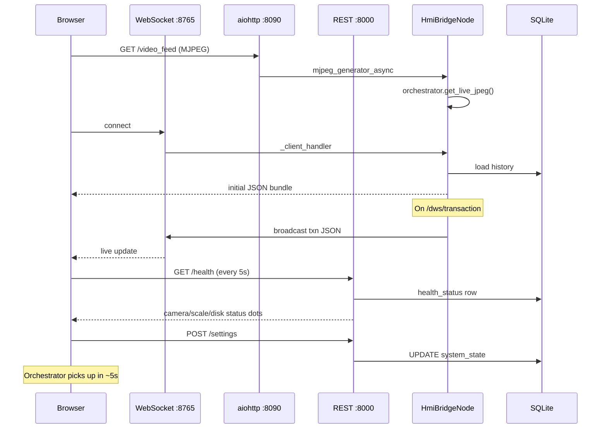

## 13.5 Settings UI

- Developer Mode toggle → `POST /settings {developer_mode: bool}`
- Reads `GET /settings` on pane open
- Header "DEV MODE" badge synced from `/system`, WebSocket, and toggle response
- Calibration lock overlay suppressed in developer mode (warning banner instead)

## 13.6 Calibration UI

- Auto-calibration trigger via WebSocket command to orchestrator (through HMI bridge hooks)
- Calibration pass/fail overlays with geometry values from auto-cal
- Reference box list loaded from DB on connect

---

# 14. Deployment

## 14.1 Development Deployment

```bash
source ~/realsense_env/bin/activate
cd ~/dws_ws/src/dws_ros2
./start_dws.sh
```

Opens three `gnome-terminal` windows (backend, API, HMI). Requires desktop session.

## 14.2 Production Deployment

```bash
cd ~/dws_ws/src/dws_ros2
deploy/run.sh start      # build, hardware checks, start detached
deploy/run.sh status
deploy/run.sh stop       # SIGTERM, fallback SIGKILL after 10s
deploy/run.sh restart
```

**Managed processes:**
1. `ros2 run dws_ros2 run_dws` → `~/.dws/logs/backend.log`
2. `uvicorn api_server:app --port 8000` → `~/.dws/logs/api.log`
3. `python3 -m http.server 8080` → `~/.dws/logs/hmi.log`

**PID files:** `~/.dws/run/{backend,api,hmi}.pid`

## 14.3 systemd

```bash
sudo deploy/install_service.sh
sudo systemctl start dws@$USER
journalctl -u dws@$USER -f
```

- **Unit:** `deploy/dws.service` (Type=simple)
- **ExecStart:** `deploy/run.sh foreground` — execs into backend as MainPID
- **Restart:** `on-failure`, 5s backoff
- **TimeoutStopSec:** 30s for graceful shutdown
- **KillMode:** control-group (stops API/HMI children)

## 14.4 Hardware Checks (deploy/run.sh)

- RealSense device enumeration via pyrealsense2
- Calibration `.npy` file presence
- Scale device node `/dev/ttyUSB0`

## 14.5 Logging

| Destination | Content |
|-------------|---------|
| `~/.dws/logs/backend.log` | All node log output from run_dws |
| `~/.dws/logs/api.log` | uvicorn access/error |
| `~/.dws/logs/hmi.log` | Static HTTP server |
| systemd journal | When run via `dws@user` service |
| Python logging | `[name][level] message` format, INFO default |

## 14.6 Directory Structure (Runtime)

```
~/
├── dws_data.db
├── .dws/
│   ├── logs/
│   └── run/
└── dws_ws/src/dws_ros2/
    ├── captures/          # JPEG snapshots
    ├── captures/pointclouds/  # .ply files (via paths.POINTCLOUD_DIR)
    ├── backups/
    └── dws_ros2/realsense_vision/calibration/  # .npy files
```

---

# 15. Threading Model

## 15.1 Thread Inventory

| Thread Name | Owner | Function | Daemon |
|-------------|-------|----------|--------|
| Main | run_dws.py | `while True: sleep(1)` | No |
| `scale_node` | ScaleNode | Serial poll loop (50Hz) | Yes |
| `barcode_node` | BarcodeNode | evdev read / stdin | Yes |
| Stream (unnamed) | VisionNodeRealSense | MJPEG frame loop (~33ms) | Yes |
| `cb-*` (per subscriber) | SimBus | Callback dispatch queues | Yes |
| Service call threads | SimBus | One-shot service handlers | Yes |
| WS asyncio thread | HmiBridgeNode | websockets + aiohttp | Yes |
| `health_monitor` | HealthMonitor | 5s health cycle | Yes |
| `disk_retention` | DiskRetention | Hourly + startup sweep | Yes |
| `dev_mode_poll` | OrchestratorNode | 5s DB poll | Yes |
| `sync_worker` | SyncWorkerNode | Cloud sync poll | Yes |
| Orchestrator callback | SimBus → Orchestrator | `_barcode_callback` (blocking FSM) | Via cb thread |

## 15.2 Threading Diagram

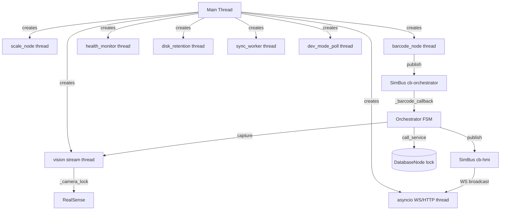

## 15.3 Locking Summary

| Lock | Protects | Contention Risk |
|------|----------|-----------------|
| `DatabaseNode._lock` | All SQL operations | Medium during high error rate |
| `VisionNodeRealSense._camera_lock` | Camera I/O + capture | **High** — stream vs capture |
| `ScaleNode._state_lock` | Latest weight snapshot | Low |
| `OrchestratorNode._state_lock` | FSM state, tx IDs | Low |
| `OrchestratorNode._calibration_lock` | Calibration exclusivity | Low |
| `HmiBridgeNode._history_lock` | In-memory deque | Low |
| `SimBus._lock` | Subscriber registry | Very low |

## 15.4 Potential Bottlenecks

1. **Camera lock contention:** Stream thread and `capture_measurement()` serialize on `_camera_lock`
2. **Blocking FSM in callback thread:** Entire barcode→save path runs in SimBus dispatch thread (weight wait up to 10s + vision up to 10s)
3. **YOLO inference:** Human detection in legacy engine adds GPU/CPU load per processed frame
4. **PE7 on capture:** Open3D point cloud write + DBSCAN segmentation at capture time
5. **SQLite write lock:** WAL mitigates but concurrent API reads during save may wait

---

# 16. Error Handling

## 16.1 Exception Flow

| Layer | Pattern |
|-------|---------|
| SimBus callbacks | try/except in `_dispatch_worker`, logged, bus continues |
| Service handlers | try/except in DatabaseNode, returns error response objects |
| Orchestrator | `_raise_error()` centralized terminal path |
| Vision capture | try/except returns `{valid: False, reason}` dict |
| perception_bridge | Never raises — returns failure dict |
| run_dws.py | Top-level try/except logs fatal, `finally` stops all nodes |
| Node stop() | Individual try/except pass — best-effort cleanup |

## 16.2 Error Types (Orchestrator)

| error_type | Severity | Component | Trigger |
|------------|----------|-----------|---------|
| `EMPTY_BARCODE` | MEDIUM | processing | Empty scan string |
| `DUPLICATE_BARCODE` | MEDIUM | processing | Same AWB within 2s |
| `NO_PARCEL` | MEDIUM | processing | Weight < 0.05 kg |
| `WEIGHT_UNSTABLE_TIMEOUT` | MEDIUM | processing | 10s stability failure |
| `CALIBRATION_REQUIRED` | MEDIUM | processing | Scan blocked by cal lock |
| `MULTIPLE_OBJECTS` | MEDIUM | processing | object_count > 1 |
| `NO_OBJECT_DETECTED` | MEDIUM | processing | object_count == 0 |
| `VISION_*` / capture reasons | MEDIUM | processing | Legacy engine rejection |
| `DB_SERVICE_FAILED` | HIGH | hardware | Service returned None |
| `DB_INSERT_FAILED` | HIGH | hardware | INSERT failure |
| `CAMERA_*` | HIGH | hardware | Camera failures |

## 16.3 Health Monitoring

5-second cycle writes to `health_status` id=1:
- Camera: live frame probe
- Scale: reading age <2s
- Database: `SELECT 1`
- Disk: free GB ≥ `min_free_disk_gb`
- Calibration: file presence + structural validation

## 16.4 Recovery Behaviour

- **Transaction errors:** Auto-recover to IDLE (never stuck in ERROR)
- **Serial disconnect:** Scale reconnects on next poll cycle
- **Scanner disconnect:** Falls back to manual input, re-detects every 10s
- **Camera start failure:** System boots degraded; operator must connect camera and restart
- **Cloud sync failure:** Retries 3× with exponential backoff; rows stay `sync_status=0`

## 16.5 Logging

- Standard Python `logging` module throughout
- Scale logs only state transitions (stable/unstable), not every reading
- Transaction success prints formatted terminal block with all dimensions
- Health, retention, sync, and migration events logged at INFO/WARNING/ERROR

---

# 17. Data Flow

## 17.1 Normal Parcel Scan

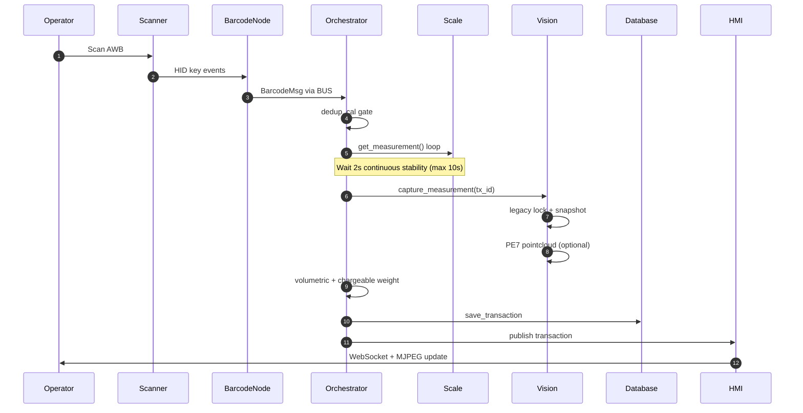

## 17.2 Calibration

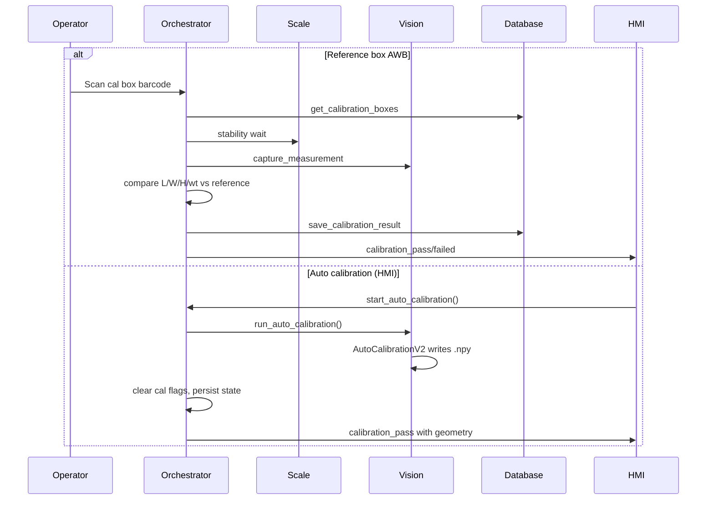

## 17.3 Cloud Synchronization

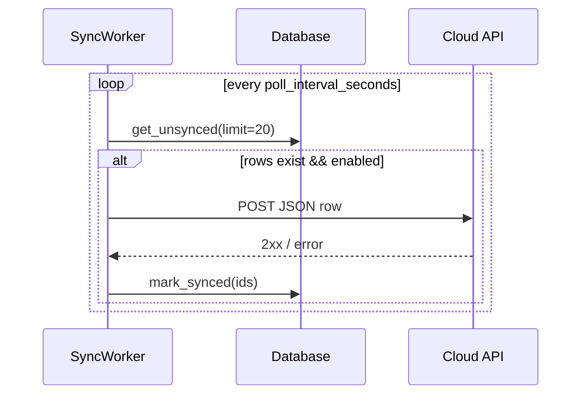

**Default:** Disabled (`sync.enabled: false`). Placeholder URL containing `example.com` force-disables sync.

## 17.4 Startup

See Section 4.5 sequence diagram.

## 17.5 Shutdown

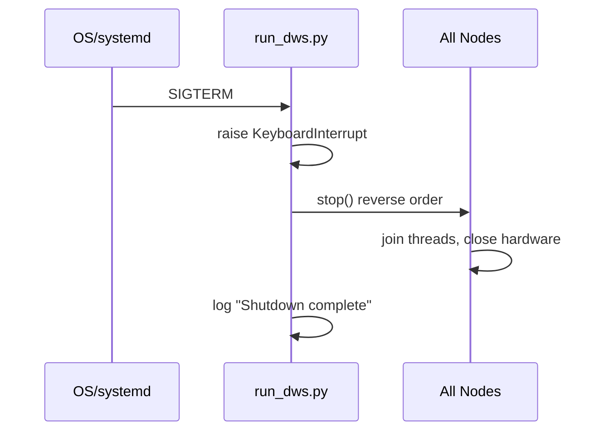

## 17.6 Error Recovery

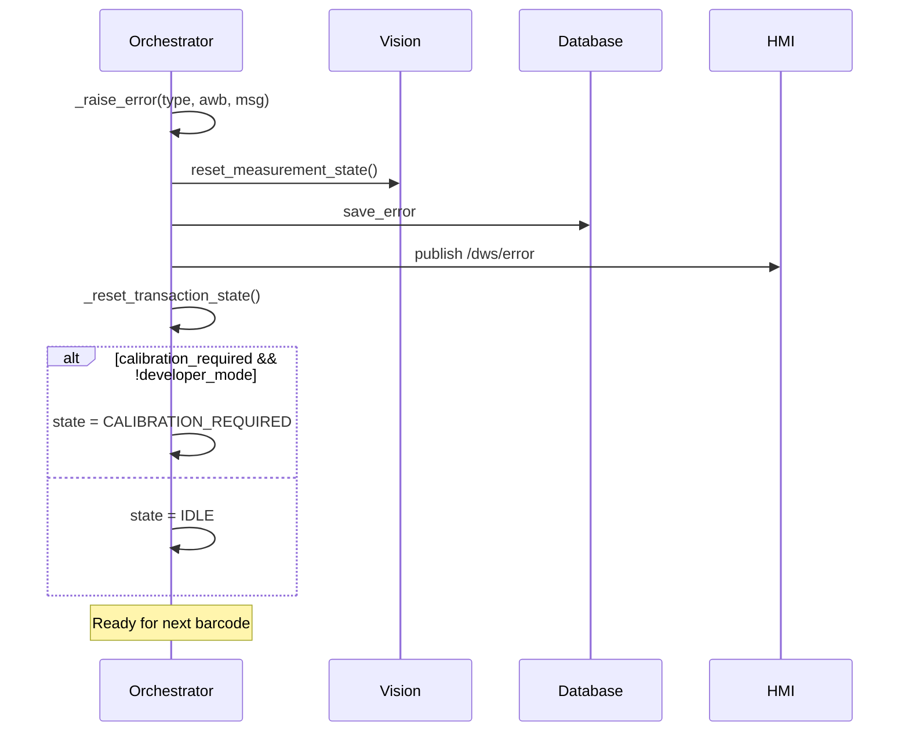

---

# 18. Engineering Decisions

## 18.1 Single-Process Runtime

| Aspect | Detail |
|--------|--------|
| **Problem** | Multi-process ROS2 adds latency and complexity for a single-station edge device |
| **Advantages** | Shared SimBus, synchronous DB saves, simpler deployment, one SIGTERM shutdown path |
| **Disadvantages** | Vision crash kills entire system; no process isolation |
| **Alternatives** | Multi-process via `dws_launch.py` (documented but SimBus incompatible cross-process) |
| **Verdict** | Appropriate for v1 edge appliance; README directs all production use to `run_dws.py` |

## 18.2 SimBus vs ROS2/rclpy

| Aspect | Detail |
|--------|--------|
| **Problem** | Need pub/sub + services without full ROS2 install on edge hardware |
| **Advantages** | Zero deps, typed callbacks, direct port path to rclpy |
| **Disadvantages** | No cross-process, no discovery, manual topic registry |
| **Alternatives** | ZeroMQ, Redis pub/sub, native rclpy |
| **Verdict** | Pragmatic simulation layer; node structure preserved for migration |

## 18.3 SQLite

| Aspect | Detail |
|--------|--------|
| **Problem** | Local persistent storage without external DB server |
| **Advantages** | Zero config, WAL concurrency, single-file backup |
| **Disadvantages** | No concurrent writers across processes (API writes settings only) |
| **Alternatives** | PostgreSQL, TimescaleDB |
| **Verdict** | Correct for offline-first edge station |

## 18.4 FSM Orchestration

| Aspect | Detail |
|--------|--------|
| **Problem** | Prevent duplicate captures, ghost transactions, unstable measurements |
| **Advantages** | Deterministic sequencing, explicit states for HMI, calibration governance |
| **Disadvantages** | Blocking callback thread during waits; many hardcoded constants |
| **Alternatives** | Event-driven actor model, PLC state machine |
| **Verdict** | Industrial-standard approach for weighing stations |

## 18.5 Dual Vision Pipeline

| Aspect | Detail |
|--------|--------|
| **Problem** | Need reliable live locking AND high-quality capture artifacts |
| **Advantages** | No regression to proven live loop; PE7 adds point clouds without blocking |
| **Disadvantages** | Two calibration consumers; dimensional authority split (legacy for txn, PE7 for PLY) |
| **Alternatives** | Full migration to PE7 for all frames |
| **Verdict** | Incremental integration strategy; bridge pattern is sound |

## 18.6 Perception Bridge

| Aspect | Detail |
|--------|--------|
| **Problem** | Integrate vendored SDK without modifying live vision node |
| **Advantages** | Cached engine, isolated failure domain, Open3D glue separated |
| **Disadvantages** | PE7 dimensions not yet authoritative in transactions |
| **Alternatives** | Inline PE7 in vision node |
| **Verdict** | Clean integration boundary |

## 18.7 Health Monitoring via DB Snapshot

| Aspect | Detail |
|--------|--------|
| **Problem** | API runs separate process, cannot call in-process health methods |
| **Advantages** | Honest cross-process health via SQLite row; stale detection |
| **Disadvantages** | Up to 5s latency; API still does independent DB ping |
| **Alternatives** | Shared memory, HTTP health sidecar on backend |
| **Verdict** | Minimal-infrastructure solution fitting SQLite-centric design |

## 18.8 Configuration Architecture

| Aspect | Detail |
|--------|--------|
| **Problem** | Previously hardcoded constants in each node |
| **Advantages** | Single YAML, env overrides, safe defaults, never fail to start |
| **Disadvantages** | Most config loaded once at start; runtime YAML save requires reload |
| **Alternatives** | etcd/consul, environment-only config |
| **Verdict** | Appropriate for field-deployable industrial system |

---

# 19. Performance Considerations

## 19.1 Memory

- **RealSense frames:** 1280×720 depth (float32) + color (uint8×3) ≈ 3.7MB per frame pair
- **Calibration arrays:** Full-frame `.npy` maps loaded once (~3–6MB each)
- **YOLO model:** YOLOv8s loaded at vision node init (~20MB+ depending on runtime)
- **PE7 point clouds:** Deprojected clouds held transiently during capture
- **HMI history deque:** Max 500 transactions in memory

## 19.2 CPU

- **Stream loop:** ~30 FPS color encode to JPEG (OpenCV)
- **Legacy engine:** Contour + RANSAC per processed frame when orchestrator calls `process_once`
- **YOLO:** Inference on color frames in legacy pipeline (when human detection active)
- **PE7 capture:** DBSCAN, RANSAC plane fit, OBB — single-shot but heavier than legacy frame

## 19.3 Latency Budget (Typical Transaction)

| Phase | Typical Duration |
|-------|-----------------|
| Barcode to stability start | <100ms |
| Weight stability wait | 2–10s (operator dependent) |
| Vision capture (lock) | 0.5–3s (20 frames at 30fps) |
| PE7 refinement | 100–500ms |
| DB save | <50ms |
| HMI broadcast | <20ms |
| **Total (barcode to HMI)** | **~3–14s** |

`latency_ms` field records barcode timestamp to save timestamp.

## 19.4 RealSense Throughput

- Configured 30 FPS; stream loop targets ~30 FPS (33ms sleep)
- Hardware filters add pipeline latency (~2-3 frames)
- Warmup: 60 frames on start, 80 frames in auto-calibration

## 19.5 Database Performance

- WAL mode allows concurrent API reads during writes
- Unique AWB index prevents duplicates at insert time
- No pagination indexes beyond primary keys (history uses `ORDER BY id DESC`)

## 19.6 Logging and Resource Management

- Disk retention prevents unbounded capture growth (default 30 days)
- MJPEG writes `latest.jpg` every frame — continuous disk I/O on stream
- Point clouds (.ply) can be large; same retention policy applies

---

# 20. Scalability

## 20.1 Current Scalability

- **Single station:** One process, one camera, one scale, one scanner — by design
- **Throughput:** Limited by 2s stability requirement + vision lock time (~3–6 parcels/minute realistic)
- **Database:** SQLite suitable to millions of rows for transaction metadata; file serving may degrade with very large capture directories

## 20.2 Multi-Station Deployment

Each station requires:
- Independent `dws_data.db` (or `DWS_DB_PATH` per station)
- Unique `station_id` in config
- Separate calibration `.npy` set per physical installation
- Cloud sync (if enabled) pushes rows independently

No central coordinator exists in v1 — stations are fully autonomous.

## 20.3 Hardware Replacement

| Component | Replacement Impact |
|-----------|-------------------|
| RealSense D455 → other model | Requires `RealSenseCamera` stream config changes + re-calibration |
| Scale | Update `scale.serial_port` / baudrate in YAML |
| Scanner | Auto-detected via evdev name; no config change if HID compatible |
| Compute platform | Paths auto-resolve via `__file__`; env overrides for custom layouts |

## 20.4 New Sensor Integration

Pattern: Create new node class → subscribe/publish on SimBus → wire in `run_dws.py` → extend orchestrator FSM if trigger-related. No plugin framework exists.

---

# 21. Current Limitations

## 21.1 Architectural Limitations

| Limitation | Detail |
|------------|--------|
| Single-process fault domain | Any unhandled exception in vision can terminate entire backend |
| SimBus not cross-process | API cannot trigger orchestrator actions (calibration, scan) |
| No multi-camera fusion | Single RealSense D455 only |
| Cloud sync disabled by default | No built-in cloud backend |
| ROS2 multi-process launch unsupported | `dws_launch.py` + SimBus incompatible |
| Dimensional authority split | Transaction DB uses legacy dimensions; PE7 dims informational |

## 21.2 Implementation Limitations

| Limitation | Detail |
|------------|--------|
| `vision.camera_mode: simulation` | Accepted in config but **not implemented** — always uses hardware |
| Barcode fallback stdin | Unusable in headless systemd without USB scanner |
| `/scanner` API endpoint | Infers online status from last transaction, not live scanner probe |
| `strict_mode`, `allow_near_oos`, `metrological_standard` | Stored in DB but not enforced in measurement pipeline |
| Operator field | Empty string — no operator login flow |
| Session operator | Not populated at session open |
| Point cloud 404 after retention | Expected — DB row remains, file pruned |
| Developer mode default | `developer_mode=1` on fresh install — calibration not enforced until disabled |
| PE7 failure silent to transaction | Point cloud may be absent even on successful dimension capture |

## 21.3 Known Technical Debt

- Hardcoded FSM constants in `orchestrator_node.py` (not in YAML)
- `print()` statements in legacy `MeasurementEngine.reset_lock()`
- Legacy `vision_node.py` retained but not used (`USE_REALSENSE = True`)
- `session_stats` table appears legacy vs newer `sessions` table
- HMI served on two ports (8080 static + 8090 embedded) — potential operator confusion
- No automated integration test suite executed in CI (per CHANGELOG Build 004 note)

## 21.4 Future Work (Documented in README)

- Multi-camera fusion
- Automatic calibration UI enhancements
- Conveyor integration
- PLC communication
- MQTT integration
- Analytics dashboard
- AI parcel classification
- Multi-object tracking

---

# 22. Future Roadmap

The following improvements preserve the current architecture while extending capability:

1. **Promote PE7 dimensions to transaction authority** — gated behind confidence threshold; legacy becomes fallback
2. **Expose FSM constants in YAML** — stability timeouts, dim factor, shipment cal limits
3. **Backend HTTP control plane** — thin REST shim in-process for calibration trigger (avoid SimBus cross-process gap)
4. **Scanner health probe** — evdev device alive check in HealthMonitor
5. **Operator authentication** — populate `operator` field from HMI login → session → transaction
6. **Enforce settings flags** — wire `strict_mode`, `metrological_standard` into measurement acceptance
7. **Simulation mode** — software depth frame generator for CI/dev without hardware
8. **MQTT publish** — post-transaction event bus for warehouse integration ( alongside existing sync worker)
9. **Capture tombstones** — DB flag when retention deletes referenced image
10. **Multi-process ROS2 port** — replace SimBus with rclpy when distributed deployment required

---

# 23. Conclusion

The DWS System v1.0 (Build 005.1) represents a production-oriented industrial measurement station implemented as a modular Python application with ROS2-compatible packaging. The architecture demonstrates several strong software engineering practices:

**Separation of concerns** is evident in the distinct node classes (barcode, scale, vision, orchestrator, database, HMI, sync, health, retention), each with explicit lifecycle methods and documented responsibilities.

**Defensive edge deployment** appears throughout: graceful camera startup without process crash, SIGTERM-driven shutdown, WAL SQLite, disk retention, honest health monitoring, and fail-closed transaction semantics with automatic FSM recovery.

**Configuration discipline** centralizes runtime tuning in YAML with safe defaults, environment overrides, and forward-only schema migration — enabling field adjustment without code changes.

**Dual vision pipeline integration** via `perception_bridge.py` shows pragmatic incremental adoption: the proven live measurement loop remains authoritative while Perception Engine v7 adds industrial-grade point cloud artifacts without risking regression.

**Observability** spans three interfaces — structured logging, REST analytics (`api_server.py` with 20+ endpoints), and real-time WebSocket/MJPEG HMI — providing operator, supervisor, and integration perspectives on the same SQLite truth store.

**Industrial workflow correctness** is enforced by the orchestrator FSM: barcode triggering, continuous weight stability, vision locking, duplicate suppression, multi-object rejection, calibration governance with developer/production modes, and persistent session/shift tracking.

This document reflects the system **as implemented** in the repository at Build 005.1 and serves as the definitive software architecture reference for engineering documentation, onboarding, design reviews, and portfolio presentation.

---

# Appendix A: Message Dataclass Specifications

All message types are defined in `dws_ros2/messages.py` as Python dataclasses (ROS2 msg/srv equivalents).

## A.1 ScaleMsg (`/dws/scale` — published internally by ScaleNode weight queue, not currently bus-published)

| Field | Type | Description |
|-------|------|-------------|
| `weight` | float | Kilograms, always positive (mean of buffer) |
| `unit` | str | Default `"kg"` |
| `timestamp` | float | Unix epoch of last reading |
| `stable` | bool | True when consecutive stable windows satisfied |

## A.2 DimensionsMsg

| Field | Type | Description |
|-------|------|-------------|
| `length`, `width`, `height` | float | Millimeters |
| `platform_height` | float | Subtracted before publishing (legacy) |
| `confidence` | float | 0–1 |
| `frame_id` | str | Default `"camera_optical"` |
| `timestamp` | float | Unix epoch |

## A.3 BarcodeMsg

| Field | Type | Description |
|-------|------|-------------|
| `data` | str | Raw AWB / tracking number |
| `timestamp` | float | Scan time |

## A.4 TransactionMsg

| Field | Type | Description |
|-------|------|-------------|
| `awb` | str | Barcode identifier |
| `tx_id` | str | UUID per scan |
| `length`, `width`, `height` | float | mm |
| `weight` | float | kg actual |
| `object_count` | int | Parcel count from vision |
| `volumetric_weight` | float | kg computed |
| `chargeable_weight` | float | max(actual, volumetric) |
| `timestamp` | float | Transaction time |
| `sync_status` | int | 0=unsynced, 1=synced |
| `station_id` | str | From config |
| `image_url` | str | Filesystem path to JPEG |
| `pointcloud_url` | str | Path to `.ply` or empty |
| `dim_factor` | float | Default 5000.0 |
| `latency_ms` | float | Barcode-to-save milliseconds |
| `operator` | str | Future operator ID |
| `confidence` | float | 0–1 from vision |

## A.5 SaveTransactionRequest / Response

**Request:** `{ transaction: TransactionMsg }`

**Response:**

| Field | Type | Description |
|-------|------|-------------|
| `success` | bool | INSERT outcome |
| `message` | str | `"OK"` or error string |
| `row_id` | int | SQLite autoincrement id, -1 on failure |

---

# Appendix B: Volumetric Weight Computation

Implemented in `orchestrator_node._barcode_callback`:

```python
DIM_FACTOR = 5000.0  # module constant, passed as dim_factor to TransactionMsg

vol_weight = math.ceil((l * w * h) / self.dim_factor)
chargeable = max(scale.weight, float(vol_weight))
```

Where `l`, `w`, `h` are millimeters from legacy vision capture. The dim factor follows standard air freight volumetric divisor convention (cm³/5000 → kg when dimensions are in mm: mm³/5000).

---

# Appendix C: Calibration Artifact Schema

## C.1 Required Files (`CALIBRATION_DIR`)

| File | Format | Contents |
|------|--------|----------|
| `stable_empty_depth.npy` | float32 (H×W) | Empty scale depth map in mm |
| `noise_map.npy` | float32 (H×W) | Per-pixel noise estimate (PE7 uses meters variant via loader) |
| `system_geometry.npy` | pickle dict | ROI, scale center, floor/scale depths, scale height |

## C.2 system_geometry.npy Required Keys

| Key | Type | Usage |
|-----|------|-------|
| `floor_depth_mm` | float | Auto-cal output, HMI display |
| `scale_depth_mm` | float | Height reference plane |
| `scale_height_mm` | float | Physical scale surface height |
| `roi_x1`, `roi_y1`, `roi_x2`, `roi_y2` | int | Region of interest pixel bounds |
| `scale_center_x`, `scale_center_y` | int | Scale platform center (via CalibrationManager) |

## C.3 AutoCalibrationV2 Process

1. Warmup 80 frames
2. Capture 120 empty-scene frames (`CAPTURE_FRAMES`)
3. Compute stable median depth map
4. Estimate scale plane via radial sampling (outer radius 180px, inner 90px)
5. Derive ROI from scale center ± `ROI_HALF_SIZE` (260px)
6. Write all three `.npy` files to `CALIBRATION_DIR`
7. Return `{success: bool, reason: str}`

---

# Appendix D: Legacy Measurement Engine Rejection Reasons

Complete list of `reason` strings returned by `realsense_vision.MeasurementEngine.process()`:

| Reason | Condition |
|--------|-----------|
| `MULTIPLE_OBJECTS` | More than one valid contour |
| `NO_PARCEL` | Zero valid contours |
| `EDGE_TOUCH` | Contour bounding box within 8px of ROI edge |
| `BAD_DEPTH` | Fewer than 8 valid depth samples in center patch |
| `BAD_HEIGHT` | Insufficient valid height delta pixels |
| `DEPTH_NOISE` | Depth delta std dev > 180 |
| `SANITY_FAIL` | Dimensions outside 40–3000mm L/W, 10–2000mm H |
| Human rejection | Via `human_detected` flag (YOLO overlap) |

Successful return: `{valid: True, locked: bool, length_mm, breadth_mm, height_mm, confidence, ...}`

Lock requires 20 consecutive frames (`LOCK_FRAMES`) in median buffers without 15mm drift (`MAX_DIMENSION_DRIFT_MM`).

---

# Appendix E: WebSocket Protocol (HMI)

## E.1 Server → Client Messages

| type | Payload | When |
|------|---------|------|
| `history` | `{data: [transactions]}` | On connect |
| `error_history` | `{data: [errors]}` | On connect |
| `calibration_boxes` | `{data: [boxes]}` | On connect |
| `transaction` | Transaction fields | Live successful scan |
| `error` | Error popup payload | Terminal failure |
| `system_state` | `{state, tx_id, timestamp}` | FSM transition |
| `calibration_required` | `{required, developer_mode}` | Cal lock |
| `calibration_warning` | `{count, dev_bypass?, reason?}` | 90 shipments or dev bypass |
| `calibration_started` | `{awb}` or auto_cal | Cal begin |
| `calibration_pass` | Result dict | Cal success |
| `calibration_failed` | Result dict | Cal failure |
| `history_refresh` | Updated transaction list | DB count change detected |

## E.2 Client → Server Messages

| event | Action |
|-------|--------|
| `start_auto_calibration` | Spawns thread calling `orchestrator.start_auto_calibration()` |

## E.3 Background DB Sync Task

`_db_history_task()` asyncio loop polls transaction and error row counts; on change, broadcasts `history_refresh` to all connected clients — keeps multiple HMI terminals synchronized without requiring a successful scan event.

---

# Appendix F: Python Dependencies

From `setup.py install_requires`:

| Package | Role |
|---------|------|
| `pyrealsense2` | Intel RealSense SDK bindings |
| `numpy` | Array operations |
| `opencv-python` | Image processing, JPEG encode |
| `open3d` | Point cloud I/O (PE7, bridge) |
| `pyserial` | Scale serial communication |
| `scikit-learn` | DBSCAN clustering (PE7 segmentation) |
| `ultralytics` | YOLOv8 human detection |
| `evdev` | Linux USB HID barcode scanner |
| `websockets` | HMI WebSocket server |
| `aiohttp` | MJPEG HTTP server, static file serve |
| `fastapi` + `uvicorn` | REST API |
| `pyyaml` | Configuration loading |

System requirements: Python 3.8+, ROS2 Jazzy (for `ros2 run` wrapper), Linux with evdev for scanner.

---

# Appendix G: ROS2 Entry Points

Registered console scripts (multi-process mode — **not primary runtime**):

| Command | Module |
|---------|--------|
| `ros2 run dws_ros2 run_dws` | **Primary launcher** |
| `ros2 run dws_ros2 vision_node_realsense` | Standalone vision (requires separate SimBus — exits with error from orchestrator standalone) |
| `ros2 run dws_ros2 scale_node` | Standalone scale |
| `ros2 run dws_ros2 barcode_node` | Standalone barcode |
| `ros2 run dws_ros2 database_node` | Standalone DB |
| `ros2 run dws_ros2 hmi_bridge_node` | Standalone HMI |
| `ros2 run dws_ros2 sync_worker_node` | Standalone sync |
| `ros2 run dws_ros2 dws_simulate` | Simulation utilities |

`orchestrator_node.main()` explicitly exits with error directing operators to use `run_dws`.

---

# Appendix H: Snapshot Directory Layout

```
captures/
├── latest.jpg              # Overwritten by MJPEG stream each frame
├── YYYY/
│   └── MM/
│       └── DD/
│           └── parcel_HHMMSS_<uuid8>.jpg
pointclouds/
└── <tx_id>.ply             # Written by perception_bridge
```

JPEG filenames: `parcel_{HHMMSS}_{8-char-uuid}.jpg` with burned-in metadata overlay (timestamp, L/W/H, confidence).

---

# Appendix I: Perception Engine v7 Module Map

| Package Path | Stage | Responsibility |
|--------------|-------|----------------|
| `capture/camera.py` | — | Standalone camera helper (not used in DWS integration — DWS uses RealSenseCamera) |
| `capture/frame.py` | 1 | Frame + Intrinsics dataclasses |
| `calibration/loader.py` | — | Loads same `.npy` files as legacy, converts units |
| `background/subtractor.py` | 2 | Empty depth subtraction |
| `background/noise_filter.py` | 3 | Temporal buffer + spatial noise suppression |
| `segmentation/parcel_segmenter.py` | 5 | CC + plane removal + DBSCAN + fallback |
| `geometry/pointcloud.py` | 6 | Deproject, clean, voxel downsample, Open3D conversion |
| `geometry/plane.py` | 4 | RANSAC plane segmentation |
| `measurement/estimator.py` | 9 | Plane-to-plane height |
| `measurement/obb.py` | 7/8 | Oriented bounding box + hull corners |
| `measurement/confidence.py` | 10 | Multi-factor confidence score 0–100 |
| `measurement/volume_estimator.py` | — | Voxel column integration |
| `core/measurement_result.py` | — | Result dataclass with `failure()` factory |
| `visualization/viewer.py` | — | Debug visualization (not wired in production) |

---

# Appendix J: Orchestrator Hardcoded Constants

These values are **not** in `dws_params.yaml` (potential future migration):

| Constant | Value | Location |
|----------|-------|----------|
| `DIM_FACTOR` | 5000.0 | orchestrator_node.py |
| `MIN_WEIGHT` | 0.05 kg | orchestrator_node.py |
| `BARCODE_DEDUP_WINDOW` | 2.0 s | orchestrator_node.py |
| `REQUIRED_STABLE_TIME` | 2.0 s | orchestrator_node.py |
| `STABILITY_TIMEOUT` | 10.0 s | orchestrator_node.py |
| `DEVELOPER_MODE_DEFAULT` | True | orchestrator_node.py (overridden by DB) |
| `DEV_MODE_POLL_INTERVAL_SECONDS` | 5 | orchestrator_node.py |

Scale stability tuning **is** configurable via YAML (buffer_size, thresholds, etc.).

---

# Appendix K: Security and Operational Notes

- **CORS:** API and HMI aiohttp middleware allow `Access-Control-Allow-Origin: *`
- **Path traversal:** `/captures/{name}` and `/pointclouds/{name}` reject `..` and slashes
- **No authentication:** REST API and WebSocket have no auth layer in v1
- **Developer mode default:** Fresh installs start with calibration enforcement disabled
- **Unique AWB constraint:** Duplicate transaction AWBs rejected at DB level with IntegrityError
- **Cloud sync:** POSTs full row JSON to configured URL; no encryption beyond HTTPS if URL uses TLS

# Appendix L: Human Detection Subsystem

The legacy pipeline integrates `HumanDetector` (`realsense_vision/human_detector.py`) to reject measurements when operator hands or persons overlap the parcel region.

## L.1 Model Configuration

| Parameter | Default | Description |
|-----------|---------|-------------|
| `model_name` | `yolov8s.pt` | Ultralytics YOLOv8 small weights |
| `confidence` | 0.25 | Detection confidence threshold |
| `imgsz` | 640 | Inference resize dimension |

The model uses **lazy loading** — weights are not loaded until first `detect()` call, allowing the vision node to construct even if the weights file must be downloaded on first run.

## L.2 Detection Logic

1. Run YOLO inference on full color frame (or ROI-cropped region when provided)
2. Filter detections to COCO person class (class id 0)
3. Build binary mask from person bounding boxes
4. Compute pixel overlap between person mask and parcel foreground mask
5. If overlap exceeds `HUMAN_OVERLAP_PX` (1500 pixels in MeasurementEngine), reject measurement

The overlap threshold is intentionally high to avoid false rejection from distant partial detections at frame edges.

## L.3 Integration Point

Called from `MeasurementEngine.process()` after contour selection but before dimension stabilization completes. When human detected, engine returns invalid result and resets lock state.

---

# Appendix M: Perception Engine Confidence Scoring

PE7 confidence (`measurement/confidence.py`) produces a 0–100 `overall` score from weighted factors:

| Factor | Weight | Meaning |
|--------|--------|---------|
| `plane_fit` | 0.20 | Top-face RANSAC inlier ratio |
| `residual_error` | 0.20 | RMS distance of points to fitted top plane |
| `coverage` | 0.15 | Point density vs expected for footprint |
| `cluster_density` | 0.15 | DBSCAN cluster tightness |
| `noise` | 0.10 | Spread relative to noise map |
| `missing_data` | 0.10 | Holes in segmentation mask |
| `obb_fit` | 0.05 | Hull vs minAreaRect area agreement |

`shape_regularity` is computed and reported but **not weighted** into overall score — irregular parcel shapes are not penalized as measurement defects.

The `shape_type` field in bridge output maps from `shape_regularity >= 0.85` → `"rectangular"`, else `"irregular"`.

Legacy engine confidence is simpler: `min(1.0, len(L_buffer) / LOCK_FRAMES)` — proportional to stabilization buffer fill.

---

# Appendix N: HMI View Architecture

The single-page HMI (`hmi/index.html`) implements these primary views via sidebar navigation:

| View | Purpose | Data Sources |
|------|---------|--------------|
| **Terminal (Live)** | Current scan display, MJPEG feed, dimension cards | WebSocket + `/video_feed` |
| **History** | Paginated transaction table | WebSocket history + `/history` API |
| **Errors** | Error log with severity badges | WebSocket error_history |
| **Calibration** | Reference boxes, auto-cal trigger, pass/fail overlays | WebSocket cal events + `/calibration/latest` |
| **Settings** | Developer mode, station name, operator, metrological flags | `GET/POST /settings` |
| **Analytics** | Throughput, success rate, weight distribution | `/stats`, `/success_rate`, `/weight_distribution`, `/billing` |

## N.1 Status Bar Indicators

Header polls `GET /health` every 5 seconds:

- **Network** — overall API reachability + health status
- **Scale** — `health.scale.ok`
- **Vision** — `health.camera.ok`

These reflect real backend probes, not merely WebSocket connectivity.

## N.2 Calibration Lock UX

Production mode (`developer_mode=false`):
- Full-screen overlay blocks terminal when `calibration_required`
- 90-shipment warning banner
- Auto-cal and reference box flows release lock on pass

Developer mode:
- Dismissible warning banner with `dev_bypass: true` reason
- Scanning continues despite missing/ expired calibration
- Status still reported honestly in `/system` and WebSocket events

---

# Appendix O: Build History Summary

| Build | Theme | Key Deliverables |
|-------|-------|------------------|
| 001 | Headless deployment | `deploy/run.sh`, systemd unit, SIGTERM graceful shutdown |
| 002 | Configuration + health | `config_loader.py`, honest `/health`, `HealthMonitor`, `DiskRetention` |
| 003 | Sessions | `sessions` table, shift tracking, `/shifts` API |
| 004 | Developer mode | Persisted `developer_mode`, cross-process poll, HMI toggle |
| 005 | Settings + export | 6 settings fields, CSV export, backup, error severity |
| 005.1 | Hardening | Unique AWB index, pointcloud serving, latency tracking |

Current version stamp: `DWS System v1.0`, Build `005.1`, dated 2026-06-22.

---

# Appendix P: Test and Simulation Assets

| File | Purpose |
|------|---------|
| `test/test_dws_system.py` | System-level pytest |
| `test_realsense_dws.py` | RealSense hardware integration test |
| `dws_ros2/simulate.py` | Simulation entry point (`dws_simulate` console script) |
| `dws_ros2/vision_node.py` | Pre-RealSense legacy vision node (retained, unused in production) |

Production runtime does not enable `stub_mode` on ScaleNode or BarcodeNode by default — stub modes exist for isolated node testing only.

---

# Appendix Q: Legacy Engine Depth Processing Detail

The first half of `realsense_vision/measurement_engine.py` `process()` method implements the following pixel-domain pipeline before contour analysis:

## Q.1 Input Normalization

- Color and depth frames must match calibration frame dimensions (1280×720 default)
- Depth values treated as millimeters (RealSense z16 scaled by device — legacy path uses float32 mm directly from camera wrapper)

## Q.2 Background Difference

```python
diff = empty_depth.astype(float32) - current_depth.astype(float32)
diff[diff < 0] = 0  # only closer-than-empty regions (parcel protrusion)
```

Threshold applied: pixels where diff is between `DEPTH_THRESHOLD_MIN` (40mm) and `DEPTH_THRESHOLD_MAX` (1000mm) become foreground.

## Q.3 Workspace and ROI Masking

- `calibration.get_workspace_polygon()` defines valid measurement polygon
- ROI rectangle from `get_roi()` further constrains processing to scale platform region
- Combined mask eliminates background beyond calibrated workspace

## Q.4 Morphological Cleaning

- Opening/closing operations remove speckle noise
- Connected component analysis removes blobs with area < 2500 pixels after initial threshold

## Q.5 Contour Filtering Parameters

| Parameter | Value | Effect |
|-----------|-------|--------|
| `MIN_CONTOUR_AREA` | 4000 px | Minimum parcel footprint |
| `MAX_CONTOUR_AREA_RATIO` | 0.25 | Reject if contour >25% of frame |
| `SOLIDITY_THRESHOLD` | 0.78 | Shape compactness gate |
| `CENTER_WEIGHT` | 2.5 | Favor contours near scale center |
| `DEPTH_PATCH_HALF` | 12 px | Half-size of center depth sampling window |

## Q.6 Pixel-to-Millimeter Conversion

`pixels_to_mm()` uses pinhole model at measured object depth:

```
mm_per_px_x = object_depth_mm / fx
mm_per_px_y = object_depth_mm / fy
```

Applied to minAreaRect width/height in pixels, with trim factors `TRIM_L=1.0`, `TRIM_B=1.0`, `TRIM_H=0.971` empirically calibrated.

---

# Appendix R: Startup Script Comparison

Two startup paths exist; operators must choose based on deployment environment.

## R.1 start_dws.sh (Interactive Development)

| Step | Action |
|------|--------|
| 0 | Kill stale processes (run_dws, uvicorn, http.server) |
| 1 | `colcon build --packages-select dws_ros2` |
| 2 | Hardware checks (non-fatal warnings) |
| 3 | Launch backend in `gnome-terminal` |
| 4 | Launch API in `gnome-terminal` with `--reload` |
| 5 | Launch HMI static server in `gnome-terminal` |
| 6 | `xdg-open http://localhost:8080/index.html` |

**Requirements:** Desktop session with GNOME terminal, X11/Wayland display, ROS2 Jazzy sourced.

**Failure mode:** Will not work over SSH without display forwarding or on headless boot.

## R.2 deploy/run.sh (Headless Production)

| Command | Behavior |
|---------|----------|
| `start` | Build, check hardware, `nohup` all three processes, write PID files |
| `stop` | SIGTERM each process, wait up to 10s, SIGKILL if needed |
| `restart` | stop + 1s sleep + start |
| `status` | Print RUNNING/STOPPED for each PID file |
| `foreground` | Start API+HMI detached, `exec ros2 run dws_ros2 run_dws` as MainPID |

**Log locations:** `$HOME/.dws/logs/{backend,api,hmi}.log`  
**PID locations:** `$HOME/.dws/run/{backend,api,hmi}.pid`

## R.3 install_service.sh

1. Requires `sudo` — refuses root-as-service-user
2. Templates `dws.service` with actual `PKG_DIR` path via sed
3. Installs as `/etc/systemd/system/dws@.service` (instance per user)
4. Enables `dws@${SUDO_USER}.service` for boot auto-start
5. Does **not** install apt/pip dependencies or build workspace — operator must pre-build

## R.4 Port Matrix

| Port | Service | Process |
|------|---------|---------|
| 8000 | REST API + OpenAPI docs | uvicorn (api_server.py) |
| 8080 | Static HMI assets | python http.server |
| 8090 | MJPEG, captures, pointclouds, embedded index.html | HmiBridgeNode aiohttp |
| 8765 | WebSocket live events | HmiBridgeNode websockets |

---

*End of Document*
